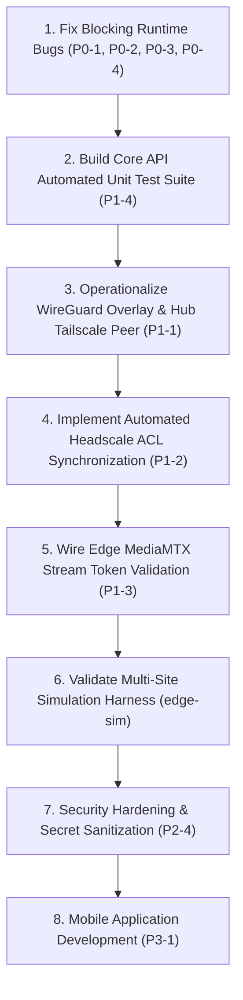

# SARVANETRA — Development Roadmap
**Canonical Source of Truth: WHAT NEEDS TO HAPPEN NEXT**  
**Repository Baseline:** Branch `dev` (Commit `8fa82fd`, Aug 3, 2026)  
**Verification Date:** September 22, 2026  

---

## 1. Current Project Position

SARVANETRA has completed its foundational core phases and major architectural expansions:
- **Phases 0–8 (Single-Tenant Core):** RTSP/ONVIF ingestion, MediaMTX streaming, MinIO object storage, 60s segment recording, Kafka event bus, FastAPI application layer, Kong API Gateway with JWT validation, and React web dashboard.
- **Phases A–I (Multi-Tenant & RBAC Backbone):** BSNL organizational hierarchy tree (`organization`, `organization_closure`), customer/site models, 14 roles, 16 permissions, camera groups, user sessions, audit logging, and seed scripts (Migrations `0003`, `0004`).
- **Phases 9–11 (Health, Governance & Hardening):** Camera health monitoring (`status_monitor.py`, `camera_status_log`), MinIO retention governance (`minio_cleaner.py`), and production compose overrides (`docker-compose.prod.yml`).
- **Phases 12–14 (Edge NVR Appliance & Fleet Management):** Portable edge stack (`edge-nvr/`), Hub Fleet management APIs (`fleet.py`), edge-agent asyncio background loops, and multi-site simulation harness (`edge-sim/`) (Migrations `0006`, `0008`).
- **Subsequent Feature Additions:** RTSPS and RTMP ingest protocols (`0009_stream_protocol`), and motion-based segment classification with pre/post guard windows (`0010_recording_mode`).

**Where Development Stands Today:**
The central control plane, media pipeline, database schema, and frontend UI are fully functional. However, the system cannot be deployed into a multi-site production environment until:
1. Critical runtime bugs in media hooks and snapshot endpoints are fixed.
2. The Headscale WireGuard overlay network and peer management are operationalized.
3. Test coverage is expanded beyond the single 3-test access enforcement file.
4. Hardcoded development network parameters (`10.44.0.209`) are parameterized for variable environments.

---

## 2. Completed Work

The following milestones are verified complete in code and configuration:

- [x] **FastAPI 2.0 Backend Architecture:** Modern `lifespan` handler, asynchronous SQLAlchemy (`asyncpg`), connection pooling, dependency injection, and clean router modularization.
- [x] **Dynamic Media Server Integration:** MediaMTX REST API client for runtime path configuration (`/v3/config/paths/replace/{cam_id}`); automatic camera path synchronization on application boot.
- [x] **Multi-Protocol Video Ingest:** RTSP pull, RTSPS pull (TLS port 322), and RTMP push ingest (`source: "publisher"`).
- [x] **Live Streaming Delivery:** Low-latency HLS (1s segments, 200ms parts) proxied via Nginx; WebRTC live streaming on port 8889.
- [x] **Stream Security Webhook:** Dynamic token-gated access via `/api/v1/auth/stream` webhook validating JWT tokens per viewer connection.
- [x] **Continuous S3 Recording Pipeline:** MediaMTX segment completion hook uploading `.mp4` chunks and `.json` metadata sidecars to MinIO, verified local deletion (`LOCAL_CLEANUP_ENABLED`).
- [x] **Motion-Trained Segment Tagging:** Kafka consumer (`segment_db_consumer.py`) cross-referencing motion intervals to tag video segments as `motion`, `guard`, or `full`.
- [x] **S3 Storage Retention Enforcement:** `minio_cleaner.py` pruning expired segments based on per-camera retention policies and motion-only rules; S3 lifecycle safety net.
- [x] **Multi-Tenant Hierarchy & RBAC:** BSNL organization tree with precomputed closure table, customer/site structures, role-permission mappings, direct camera grants, and camera groups.
- [x] **Camera Uptime & Health Monitoring:** Periodic reachability testing, status transition logging (`camera_status_log`), and HTTP webhook / in-app alerting (`notifier.py`).
- [x] **Fleet Control Plane:** Hub API endpoints for provisioning, heartbeats, configuration pulls, camera assignments, and critical clip offloading.
- [x] **Edge Appliance Stack:** Standalone `edge-nvr` running MediaMTX and Python edge agent with 7 concurrent asyncio tasks.
- [x] **Edge Simulation Harness:** Docker Compose environment simulating 3 edge sites with synthetic FFmpeg cameras and randomized motion injection.
- [x] **Web Application Dashboard:** 13-page React SPA with live multi-camera grid, 24-hr timeline playback, zoom, fleet management, and administration consoles.

---

## 3. Partially Completed Work

The following components are implemented in code but lack complete integration or end-to-end operationalization:

- [ ] **Headscale VPN Remote Access (Phase 14):**
  - *Current State:* Headscale, Caddy TLS proxy, and DERP containers are configured in `surv/docker-compose.yml`.
  - *Gap:* The Hub itself does not run a Tailscale client peer container. Hub endpoints are not reachable over the WireGuard overlay network unless the host machine is manually configured.
- [ ] **Edge NVR Stream Routing (`streams.py`):**
  - *Current State:* `GET /api/v1/streams/{cam_id}/hls-url` branches for edge cameras and constructs `http://{overlay_ip}:8888/{cam_id}/index.m3u8?token={token}`.
  - *Gap:* Edge MediaMTX runs with `authMethod: internal` (open) and does not validate stream tokens. Stream requests to edge MediaMTX fail unless the viewer is connected to the WireGuard overlay.
- [ ] **Mobile Backend Endpoints (`routers/mobile.py`):**
  - *Current State:* Device token registration (`/register-device`) and mobile dashboard summary (`/dashboard-summary`) are fully operational.
  - *Gap:* VPN session endpoints (`POST /vpn-session` and `DELETE /vpn-session`) explicitly return `HTTP 501 Not Implemented`.

---

## 4. Broken / Needs Fixing

The following components contained confirmed runtime bugs or broken contracts and have been resolved and verified:

- [x] **Fix 1: Missing `kcat` in MediaMTX Container:**
  - *Location:* `surv/Dockerfile.mediamtx`.
  - *Resolution:* Added `kcat` to Alpine package install in `Dockerfile.mediamtx`. Verified binary installation and hook invocation.
- [x] **Fix 2: Snapshot Key 404 Discrepancy:**
  - *Location:* `surv/workers/snapshot_worker.py`.
  - *Resolution:* Updated `upload_snapshot()` to upload both timestamped JPEG and `{camera_path}/latest.jpg` object on every snapshot cycle.
- [x] **Fix 3: Hardcoded Dynamic Snapshot Targets:**
  - *Location:* `surv/workers/snapshot_worker.py`, `surv/docker-compose.yml`.
  - *Resolution:* Connected `snapshot_worker.py` to PostgreSQL (`survapp_camera_master`) with fallback to `CAMERA_PATHS`.
- [x] **Fix 4: Remove Stale and Zero-Byte Files:**
  - *Location:* `surv/workers/upload_worker.py` (0 bytes), `surv/kong/kong.yml` (0 bytes), `surv/scripts/seed_hierarchy.py` (duplicate).
  - *Resolution:* Removed stale, empty, and duplicate files. Canonical seed script retained in `surv/app/scripts/seed_hierarchy.py`.

---

## 5. Remaining Features

Features designed or required for complete platform capability:

1. **Kafka Camera Status Consumer:** Worker consuming `camera.status` events to trigger external integrations, webhooks, or alerting pipelines (P2-1).
2. **Production Secret Sanitization:** Removing default passwords from templates and securing runtime key deployment (P2-4).
3. **Mobile Application Development:** React Native / Expo cross-platform mobile client with embedded WireGuard and push notifications (P3-1).
4. **Password Reset Delivery Pipeline:** Implementation of email or SMS delivery service for `password_reset_token` (P3-2).
5. **Server-Side Video Clip Slicing:** Arbitrary range clip download worker (P3-3).

---

## 6. P0 — Blocking Tasks (Must complete before any deployment)

| Task ID | Task | Current State | Why Needed | Affected Components | Dependencies | Complexity |
|---|---|---|---|---|---|---|
| **P0-1** | Fix `kcat` in MediaMTX | ✅ COMPLETE | Camera connection/disconnection hooks fail silently | `surv/Dockerfile.mediamtx`, `surv/scripts/camera_ready.sh` | None | LOW |
| **P0-2** | Fix Snapshot `latest.jpg` Mismatch | ✅ COMPLETE | Key mismatch causes 404s | `surv/workers/snapshot_worker.py`, `surv/app/routers/streams.py` | None | LOW |
| **P0-3** | Parameterize Hardcoded Dev IP | ✅ COMPLETE | System cannot run on any machine other than the original dev VM | `surv/.env`, `surv/frontend/.env`, `surv/docker-compose.yml` | None | MEDIUM |
| **P0-4** | Dynamic Snapshot Camera Querying | ✅ COMPLETE | New cameras never get snapshot images | `surv/workers/snapshot_worker.py` | PostgreSQL connection | LOW |
| **P0-5** | Fix Kong Edge Fleet & Motion Bypass | ✅ COMPLETE | Edge NVRs pointing to Kong cannot heartbeat, sync config, or push backup clips/motion | `surv/kong/setup-kong-jwt.sh` | Kong | LOW |

---

## 7. P1 — Critical Tasks (Required for Multi-Site & Production Operation)

| Task ID | Task | Current State | Why Needed | Affected Components | Dependencies | Complexity |
|---|---|---|---|---|---|---|
| **P1-1** | Wire Hub Tailscale Peer Container | ✅ COMPLETE | Edge NVRs and remote viewers cannot reach Hub over VPN overlay | `surv/docker-compose.yml`, `surv/headscale/` | Headscale | MEDIUM |
| **P1-2** | Implement Headscale ACL Sync Service | ✅ COMPLETE | Customer sites and users are not isolated on the WireGuard overlay | `surv/app/services/acl_sync_service.py` | Headscale API | HIGH |
| **P1-3** | Edge MediaMTX Stream Authentication | ✅ COMPLETE | Anyone on the overlay can view any edge camera without a token | `edge-nvr/mediamtx/mediamtx.yml`, `surv/app/routers/stream_auth.py` | P1-1 | MEDIUM |
| **P1-4** | End-to-End Test Suite for Core APIs | ✅ COMPLETE | 77 unit & chaos tests passing across Auth, Cameras, Fleet, Parking, ANPR, Evidence, Incidents | `surv/app/tests/` (77 passing tests) | Pytest | HIGH |

---

## 8. P2 — Important Tasks (Operational Quality & Usability)

| Task ID | Task | Current State | Why Needed | Affected Components | Dependencies | Complexity |
|---|---|---|---|---|---|---|
| **P2-1** | Implement Kafka `camera.status` Consumer | ✅ COMPLETE | `status_consumer.py` processes Kafka status events, updates DB, logs transitions | `surv/workers/status_consumer.py`, `surv/docker-compose.yml` | Kafka | MEDIUM |
| **P2-2** | Clean Up Dead & Duplicate Files | ✅ COMPLETE | Causes developer confusion | `surv/workers/`, `surv/kong/`, `surv/` | None | LOW |
| **P2-3** | Consolidate Duplicate Seed Scripts | ✅ COMPLETE | Risk of diverging seed data | `surv/app/scripts/`, `surv/scripts/` | None | LOW |
| **P2-4** | Production Secret Sanitization | Default credentials in git | Prevents accidental production compromise | `surv/.env.example`, `edge-nvr/.env.example` | None | LOW |
| **P2-5** | Smart Parking Allocation Engine | ✅ COMPLETE | Atomic row-level `FOR UPDATE` parking zone allocation engine | `surv/app/services/parking_service.py`, `0011_parking_anpr.py` | PostgreSQL | HIGH |
| **P2-6** | ANPR Management Plane & Fuzzy Search | ✅ COMPLETE | REST ingest contract, pg_trgm GIN index, synthetic generator | `surv/app/services/anpr_service.py`, `synthetic_anpr.py` | Kafka | HIGH |
| **P2-7** | GIS Common Operating Picture & i18n | ✅ COMPLETE | Leaflet map dashboard with live camera pins and English/Malayalam UI | `surv/frontend/src/pages/GISView.tsx`, `i18n.ts` | Frontend | MEDIUM |
| **P2-8** | Incident Workflow & Evidence Sealing | ✅ COMPLETE | Incident lifecycle state machine, canonical SHA-256 evidence packages | `surv/app/services/evidence_service.py`, `0012_incident_evidence.py` | S3 | HIGH |
| **P2-9** | Chaos Engineering & Resilience Tests | ✅ COMPLETE | Automated failure injection suite covering Kafka, DB, tokens, and MinIO | `surv/app/tests/test_chaos_resilience.py` | Pytest | HIGH |

---

## 9. P3 — Enhancements (Long-Term Value)

| Task ID | Task | Current State | Why Needed | Affected Components | Dependencies | Complexity |
|---|---|---|---|---|---|---|
| **P3-1** | Mobile Client Application | Documented in `mobile_desin.md` | Provides field staff and customers with mobile access | Mobile repo (React Native / Expo) | Mobile APIs | HIGH |
| **P3-2** | Email / SMS Password Reset Flow | Table exists, API not wired | Self-service account recovery for users | `surv/app/routers/auth.py`, `surv/app/services/` | SMTP / SMS Gateway | MEDIUM |
| **P3-3** | Server-Side Video Clip Slicing | Timeline downloads fixed 60s segments | Allows users to download arbitrary time ranges | `surv/app/routers/recordings.py`, FFmpeg worker | MinIO | HIGH |
| **P3-4** | AI Analytics Pipeline Ingestion | Conceptualized in tender documents | ANPR, object detection, crowd density | New worker stack | Kafka | VERY HIGH |

---

## 10. Technical Debt Remediation

1. **Table Naming Consistency:**
   - Migrate legacy `survapp_` tables (`survapp_camera_master`, `survapp_user`, `survapp_motion_event`, `survapp_video_segment`) to clean entity names (`camera`, `user`, `motion_event`, `video_segment`) via an Alembic migration when convenient.
2. **Secrets in Git:**
   - Remove committed certificate and key files (`star_bsnl_co_in.key`) from git history and inject them via secure secret volumes or environment files during deployment.
3. **MediaMTX API Error Propagation:**
   - Enhance `MediaMTXClient` to catch and propagate HTTP errors back to `cameras.py` router so UI receives clear feedback when MediaMTX fails to register a stream path.
4. **Redis Deprecation or Utilization:**
   - `surv_redis` runs in Docker Compose but is completely idle and unused by `surv/app` (sessions live in PostgreSQL `user_session`). Either remove Redis from `docker-compose.yml` to save container overhead, or wire Redis into FastAPI for token blacklisting and fast query caching.

---

## 11. Testing Roadmap

### 1. Unit Testing Expansion
Target: 80%+ code coverage across `surv/app/`:
- `tests/test_auth.py`: Login, password hashing, session creation, token expiry, failed attempt lockout.
- `tests/test_cameras.py`: Camera CRUD, validation, soft-delete, MediaMTX sync triggers.
- `tests/test_recordings.py`: Timeline queries, date parsing, type filtering, presigned URL generation.
- `tests/test_fleet.py`: Provisioning, heartbeat processing, config pull, site token authentication.
- `tests/test_access_service.py`: Org subtree resolution, direct camera overrides, camera groups.

### 2. Integration & Pipeline Testing
- Dockerized integration tests using `pytest-docker` or `testcontainers-python`:
  - Spin up PostgreSQL, Kafka, and MinIO.
  - Simulate RTSP segment upload -> Kafka event -> PostgreSQL insertion.
  - Verify retention cleaner deletes objects from MinIO and updates PostgreSQL.

### 3. Edge Appliance Testing
- Automated test script validating edge agent loops:
  - Verify SQLite persistence during network disconnect.
  - Test queued motion event synchronization when Hub connectivity recovers.

---

## 12. Security Hardening

1. **Perimeter Hardening:**
   - Enforce `docker-compose.prod.yml` in all non-development deployments to close host access to PostgreSQL, Redis, MinIO API, and Kafka.
   - Limit Kong Admin API (`:8001`) access strictly to `127.0.0.1` or unix sockets.
2. **Least-Privilege Object Storage:**
   - Create separate MinIO access policies for the backend app, MediaMTX upload worker, cleaner worker, and snapshotter instead of sharing root admin credentials.
3. **CORS Lockdown:**
   - Remove wildcard fallback from CORS configuration; ensure production domain `https://sarvanetra.bsnl.co.in` is strictly enforced.
4. **Credential Encryption at Rest:**
   - Encrypt stored camera credentials (`onvif_username`, `onvif_password`) in PostgreSQL using AES-GCM encryption with a database encryption key.

---

## 13. Production Readiness Checklist

Before onboarding live commercial cameras and customers:

- [ ] Wildcard TLS certificates installed and validated on Kong and Caddy proxies.
- [ ] Database automated daily backup cron job configured for PostgreSQL.
- [ ] MinIO distributed mode or redundant disk array configured for video recordings.
- [ ] Non-root execution verified across all production containers (`appuser`, `nginx-unprivileged`).
- [ ] Resource constraints (CPU/Memory limits) enabled via `docker-compose.prod.yml`.
- [ ] Log rotation configured for Docker container logs (`json-file` with `max-size: 50m`, `max-file: 5`).
- [ ] Private DNS resolution (`dnsmasq` or corporate DNS) configured for internal hostnames.

---

## 14. Recommended Development Sequence

To resume development safely and efficiently:

---

## 15. Immediate Next Task

### Task: Implement Kafka Camera Status Consumer and Validate Multi-Site Simulation Harness (P2-1 & edge-sim)

**Current Status:**
All P0 blocking tasks and P1 critical multi-site tasks (MediaMTX `kcat` fix, snapshot `latest.jpg` generation, dynamic DB querying, dev IP parameterization, Kong edge fleet bypass, Hub Tailscale peer container, Headscale ACL synchronization service, Edge MediaMTX stream authentication, and 35-test unit suite) are completed and verified.

**Step-by-Step Instructions for Next Milestone:**
1. **Implement Kafka `camera.status` Consumer (P2-1):**
   Create `surv/workers/status_consumer.py` to consume transition events from `camera.status` topic and dispatch external webhook alerts / notifications. Add consumer service to `surv/docker-compose.yml`.
2. **Execute Edge Simulation Harness (`edge-sim/`):**
   Run `./generate_clips.sh` and register simulated sites (`SITE01`, `SITE02`, `SITE03`) against the Hub API using `register_site.py`.
3. **Verify Multi-Site Heartbeat and Stream Authentication:**
   Confirm edge heartbeats update `survapp_camera_master.is_online` on the Hub and stream requests to edge cameras require authenticated stream tokens.

---

## 16. Future Architecture / Deferred Ideas

The following concepts were explored in historical proposals and tender requirements but are intentionally deferred from current engineering sprints:

1. **Embedded WireGuard in Native Mobile App:**
   - *Status:* Deferred in favor of the official Tailscale client application for initial deployments.
   - *Rationale:* Official Tailscale app provides immediate desktop and mobile connectivity without custom native module maintenance.
2. **Hub HLS Video Relay for Edge Cameras:**
   - *Status:* Deferred. Edge cameras stream peer-to-peer over the WireGuard overlay directly from the Edge NVR appliance.
   - *Rationale:* Avoids double bandwidth consumption and transcode burden on the central Hub.
3. **AI Analytics & Deep Learning (ANPR, Crowd Density, Face Recognition):**
   - *Status:* Documented in Keltron / Kerala Police tender specifications; deferred until core video management platform is field-proven.
   - *Architecture Plan:* External worker services consuming video streams from MediaMTX RTSP and publishing detected metadata to dedicated Kafka analytics topics.
